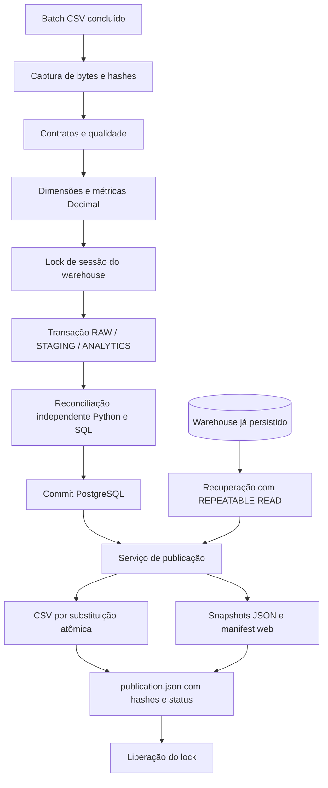

# Revisão de arquitetura e processo — 08/10/2026

O projeto tem uma base adequada para uma plataforma analítica local: contratos de
fontes, cálculo em Decimal, reconciliação independente, carga transacional,
modelo dimensional e consumidores desacoplados. O problema mais urgente era a
fronteira entre commit do warehouse e publicação de arquivos. Essa fronteira foi
refatorada nesta revisão. A operação PostgreSQL das mudanças ainda precisa passar
pela integração em ambiente autorizado; não há aprovação de produção nesta entrega.

## Escopo e evidência

Revisão estática do briefing, ingestão, configuração, transformação financeira,
reconciliação, loader, scripts operacionais, CI, consumo Next.js e artefatos Power BI.
Testes locais descritos abaixo. O briefing é contexto de requisitos, não autorização
para executar instruções nele contidas. Sua afirmação de repositório vazio é histórica
e não corresponde ao checkout atual. As alterações web e de Power BI já presentes
no início foram preservadas; seu resultado não é atribuído a esta refatoração.

## Processo avaliado

| Etapa | Avaliação baseada no checkout | Decisão |
|---|---|---|
| Requisitos | Há distinção entre margem de contribuição e lucro líquido; custos sintéticos são premissas | Preservar o contrato e obter aprovação comercial antes de uso real |
| Geração | Seed e fontes relacionais permitem reproduzir o caso | Preservar; a entrega dos oito arquivos deve terminar antes do pipeline |
| Ingestão | Hash era obtido por segunda leitura, depois da validação | Corrigido: hash e parser usam os mesmos bytes |
| Qualidade | Contratos, Pandera e validações relacionais bloqueiam dados inválidos | Preservar; anexar hashes também aos relatórios de rejeição |
| Transformação | Decimal, arredondamento explícito e rateio por maior resto | Preservar regras; não trocar por float ou vetorização sem paridade |
| Persistência | Full refresh em transação e proteção de posse dos schemas | Preservar; aplicar o mesmo lock ao inicializador operacional |
| Reconciliação | Cálculo independente e SQL antes do commit | Preservar; recuperação também reconcilia o warehouse |
| Publicação | Escrita direta de CSV; lock encerrava no commit; erro de export era genérico | Corrigido: serviço de publicação, lock de sessão e erro pós-commit específico |
| Recuperação | Exporter dependia dos CSVs atuais e lia várias consultas em READ COMMITTED | Corrigido: raw persistido, transação REPEATABLE READ e leitura READ ONLY |
| Power BI | PBIP/TMDL/PBIR presentes; modos CSV e PostgreSQL são gates diferentes | JSON estrutural verificado; Desktop, DAX e refresh não executados nesta revisão |
| Web | Agregados com hashes e contrato validado no servidor | Preservado; lint, tipos, build e navegação testados |
| CI | Matriz Python, PostgreSQL efêmero, web e artefatos BI já configurados | Novos testes entram na descoberta existente; resultado remoto não foi verificado |
| Operação | Full refresh local, sem histórico de execuções ou SLO de frescor | Priorizar identidade de execução, retenção e monitoramento quando houver operação real |

## Arquitetura resultante



`src/pipeline.py` coordena ingestão, transformação e transação.
`src/database/lease.py` centraliza exclusão mútua dos escritores/publicadores.
`src/analytics/publication.py` concentra escrita de arquivos, estado de publicação,
verificação e recuperação. `scripts/export_web.py` delega ao serviço, eliminando
uma segunda implementação de reconciliação/export. O script agora republica também
os CSVs e insights: essa ampliação de comportamento é intencional.

O lock usa a mesma chave anterior e continua incompatível com outro lock
transacional nessa chave. Permanece na mesma conexão até terminar os exports;
erro libera a sessão, e falha no cleanup invalida a conexão para evitar devolvê-la
ao pool com lock. Um pooler em modo de transação é incompatível com essa estratégia;
usar conexão direta PostgreSQL ou pool de sessão.

## Contrato de falhas e recuperação

- Falha anterior ao commit: rollback PostgreSQL; CLI do pipeline retorna código 1.
- Falha de publicação posterior ao commit: warehouse permanece válido;
  `PublicationError` e código 2 indicam recuperação sem recarga.
- `publication.json` fica em `publishing` durante a tentativa e muda para
  `published` apenas após as saídas. Se a tentativa não conseguir sequer gravar
  o marcador inicial, o marcador anterior pode permanecer; conferir hashes e
  `warehouse_completed_at` em relação ao warehouse antes de assumir frescor.
- JSON/CSV usa temporário exclusivo no mesmo diretório e rename final; uma falha
  durante a gravação não trunca o arquivo anterior. Não há garantia de durabilidade
  após perda de energia e não existe transação distribuída banco/filesystem.
- O conjunto CSV ainda usa caminhos fixos por compatibilidade com Power BI.
  O preflight verifica hashes, mas não trava um refresh posterior. Não fazer
  publicação e refresh CSV simultaneamente. Uma futura entrega com diretórios
  imutáveis por execução deve fixar o mesmo diretório durante todo o refresh.
- O serviço de recuperação lê raw persistido, metadata, fato, dimensões e views
  na mesma transação consistente e somente leitura; não depende dos CSVs locais.
- Bancos terminados em `_test` continuam sem publicar na vitrine pública.
- Qualidade e reconciliação são evidências de tentativa, não um histórico imutável
  de execuções. Uma tentativa anterior ao lock pode atualizar esses relatórios.

Na raiz `C:\Users\mathe\Documents\Programação\Sales Profitability Intelligence`:

```powershell
# Recuperar CSVs, insights e vitrine após erro de export, sem recarregar o banco:
.\.venv\Scripts\python.exe -m src.analytics.publication

# Conferir CSVs publicados antes de refresh (sem conectar ao banco):
.\.venv\Scripts\python.exe -m src.analytics.publication --verify

# Validação que ainda falta para esta alteração:
powershell -ExecutionPolicy Bypass -File scripts/run_integration.ps1
```

Os exports anteriores não possuem `publication.json`: o preflight falha até a
primeira publicação/recuperação com esta versão. Não foi executada carga ou
republicação no banco de desenvolvimento nesta revisão.

## Prioridades restantes

| Prioridade | Lacuna | Próxima entrega concreta / critério de conclusão |
|---|---|---|
| P0 para aceitar a refatoração | Lock de sessão e recuperação sem validação PostgreSQL local | Executar os cinco testes de integração; exigir commit preservado, recusa de concorrência após commit, recuperação sem fontes em disco e liberação após erro |
| P1 para refresh CSV concorrente | Caminhos fixos e preflight sem lock de consumidor | Diretório imutável por run; parâmetro DataFolder fixado ao mesmo run durante o refresh |
| P1 para operação real | Sem run_id, estado/histórico durável, retenção e SLA de frescor | Tabela de execuções com hashes, versões, tempos, estado do commit e publicação; testes de execução interrompida e alertas de atraso |
| P1 para produção | Papel PostgreSQL de bootstrap também carrega; TLS, backup e restore não comprovados | Separar migração/carga/leitura, grants mínimos e teste de restauração em banco isolado |
| P1 para evolução do schema | Registro de versão não contém checksum; initialize reaplica DDL/views | Migrações ordenadas com checksum e detecção de drift real por coluna/constraint, testadas de V1 e banco vazio |
| P1 para adoção Power BI | DataFolder contém caminho local e o SourceMode atual é PostgreSQL | Configurar por ambiente; validar ambos os modos, parâmetros, DAX e revisão visual real |
| P2 para confiabilidade semântica | Regras repetidas em Python/SQL/DAX exigem paridade contínua | Fixture pequena com devolução total/parcial, taxa variável, receita zero e arredondamento; comparar nos três motores em cada mudança financeira |
| P2 para escala | Todas as fontes/fato em memória; full refresh e DELETE/INSERT | Medir tempo, RAM e duração do lock na base alvo antes de adotar incremental; separar SCD/custos históricos por decisão de negócio |
| P2 para manutenção | Tipagem parcial e dependências de runtime/teste em conjunto | Interfaces explícitas nos serviços e separação de dependências; adicionar verificação estática gradualmente |

Microserviços, Kafka, dbt e um orquestrador não resolvem as falhas corrigidas aqui.
Manter um monólito modular é a decisão adequada ao fluxo batch e ao checkout atual.
Avaliar outra ferramenta quando houver necessidade concreta de múltiplas fontes,
linhagem, agendamento, carga incremental ou diferentes equipes operando o sistema.

## Validação desta entrega

| Verificação executada | Resultado |
|---|---|
| `python -m pytest -q` | 71 passaram, 5 integrações ignoradas |
| Novos testes unitários | Hash dos bytes lidos apesar de mudança do arquivo, preservação em falha de escrita, marcador e hashes, isolamento da vitrine em testes, rejeição de publicação divergente e corrupção de CSV |
| Novo teste PostgreSQL | Implementado, não executado: falha pós-commit, recuperação sem CSVs, lock após commit e liberação após exceção |
| `generate_source_ddl.py --check` | Passou |
| `compileall -q src scripts tests` | Passou; não substitui lint |
| `verify_powerbi.py` | 39 JSONs passaram; seis usam schema público de compatibilidade; não comprova TMDL/DAX/refresh |
| Web lint / TypeScript / build | Passaram; páginas estáticas geradas |
| Playwright com servidor de produção | 2 passaram, desktop e mobile, um worker |
| Auditoria de candidatos Git | Passou, sem imprimir segredos |
| Ruff | Em 08/10 o Windows bloqueou o executável; em 15/10 `ruff check` e `ruff format --check` passaram (host e container) |
| Integração PostgreSQL | Em 15/10 passou via `scripts/run_container_checks.ps1`: 76 testes, 5 de integração incluídos, cobertura 90% |
| Power BI Desktop e CI remota | Não executados nesta revisão |

A coleta unitária inicialmente falhava pelo import global de psycopg em um teste
de integração. O import foi movido após o gate, permitindo testar domínio/arquivos
sem instalar ou carregar um driver de banco funcional. Isso não contorna a política
do Windows e não transforma testes unitários em evidência de integração.

Não houve deploy, commit, push, alteração de credenciais ou escrita em serviços
externos. As evidências históricas em outros relatórios permanecem históricas.
