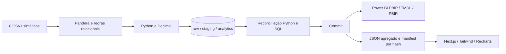
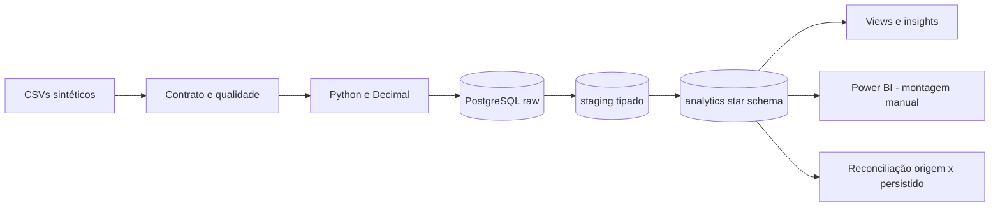

# Arquitetura

## Revisão vigente — 08/10/2026

O pipeline e o inicializador agora mantêm lock de sessão até terminar suas operações;
a publicação usa temporários exclusivos por arquivo, marcador de status/hashes e
recuperação sem recarga a partir do raw persistido. Hash e leitura CSV usam os mesmos
bytes. O comando de recuperação lê sob REPEATABLE READ e READ ONLY.

[Revisão completa, validação e riscos](architecture-review-2026-10-08.md) ·
[ADR-006](adr/006-recoverable-publication.md).
Integração PostgreSQL destas mudanças passou em 15/10/2026 (container descartável). Os parágrafos abaixo
são o registro V1/V2 anterior: referências a lock transacional e rerun como única
recuperação foram substituídas pela revisão acima.

## V2 vigente

Fonte adicional variable_costs, contratos declarativos Pandera sem coerção Decimal,
DDL físico raw/staging em SQL e migração transacional 002. A contribuição inclui
taxas sobre receita líquida e embalagem por item não cancelado.
Snapshot full-refresh e advisory lock foram preservados; oito totais reconciliados.
Schema migration registra versão 2 e zero legado é explicitamente custo não modelado.

Power BI aberto/carregado/salvo e DAX executado; paridade documentada em validation.md.
O modo snapshot é independente da autenticação da conexão PostgreSQL direta.
Web recebe somente agregados e valida hashes; não recebe conexão/credenciais nem
clientes individualizados. Export só é publicado depois do commit conciliado.
Detalhes: ADRs 003–005. A descrição a seguir preserva decisões V1 e suas limitações.

Decisão comercial: receita pode crescer sem rentabilidade; derivar contribuição
em dados transacionais e manter rastreabilidade até os CSVs de origem.

Implementação: Python lê e valida todas as fontes antes de escrever no banco,
normaliza texto/datas/números, calcula a fato e constrói dimensões. Um único commit
PostgreSQL grava raw (texto da origem), staging (tipado) e analytics (grão item),
após reconciliação do dado persistido. As setas representam a linhagem lógica;
as transformações executam em Pandas/Decimal e não em jobs SQL entre schemas.
Raw conserva os campos da leitura CSV, mas não é log histórico append-only.

Full refresh transacional, idempotente para mesma origem. Sem drop de tabela ou
volume. `pipeline_metadata` identifica posse/versão dos schemas. Schemas existentes
sem marker correto e tabelas inesperadas impedem carga. Advisory lock transacional
recusa pipelines simultâneos no mesmo banco. Falha de reconciliação reverte DDL/DML.
Dimensões usam IDs naturais positivos como surrogate keys estáveis neste MVP.
Mudança de esquema exige migração futura; `IF NOT EXISTS` não migra contratos.

Qualidade: validação de colunas, nulidade, chaves, tipos, ranges, datas, devoluções
acumuladas, estados do pedido e completude do frete. CSV inválido gera JSON e aborta
antes de tocar o banco. Não remove duplicatas silenciosamente.

Reconciliação: sete totais financeiros calculados independentemente da transformação,
IDs e quantidade da fato, frete de cada pedido; consulta SQL separada recalcula quatro
totais a partir de staging. Dinheiro tem tolerância zero por trabalhar com centavos.

Saídas CSV/JSON são locais, após commit para exports. Relatório de reconciliação
é evidência da tentativa, não substitui `pipeline_metadata.completed_at` como prova
de commit. Se export falhar depois do commit, banco permanece válido e arquivos
podem ficar incompletos: corrigir o destino e reexecutar. Não há transação distribuída.

Segurança: URL criada com SQLAlchemy.URL (senha fora de logs), parâmetros ocultos,
SQL externo parametrizado, SQL estático do repositório, portas Docker em loopback.
Credenciais só via ambiente/.env ignorado. PostgreSQL local usa usuário de bootstrap;
produção deve separar role de migração, carga e leitura, restringir grants e usar TLS.
PgAdmin é ferramenta local opcional via profile `tools`.

Limites: snapshots locais, sem scheduler, CDC, incremental, data lineage externo,
observabilidade SaaS ou servidor web. Power BI é especificado; não foi construído.
