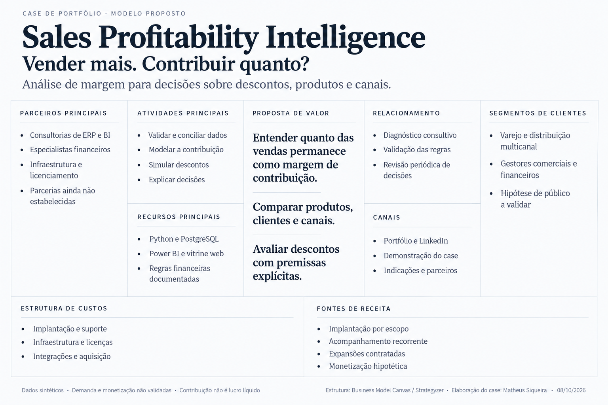

# Modelo de negócios — Sales Profitability Intelligence

**Objetivo:** valorizar o case no portfólio, demonstrando compreensão do problema de negócio, desenho de produto e responsabilidade na interpretação dos dados. **Data:** 08/10/2026.

**Tese:** ajudar gestores comerciais e financeiros a entender quanto das vendas permanece como margem de contribuição e avaliar descontos, mix de produtos e canais com uma trilha verificável dos números.

Este documento desenha uma possibilidade de negócio. Não comprova demanda, clientes, receita recorrente, preço aceito ou retorno financeiro. A demonstração utiliza dados sintéticos; os números das vendas pertencem ao cenário analítico, não ao faturamento deste projeto.

## 1. Problema, público e proposta

O problema tratado pelo case é a distância entre vender mais e contribuir mais: descontos, devoluções, CMV, frete, taxas e embalagem podem mudar a leitura de uma venda. A dor de empresas reais ainda precisa ser confirmada em entrevistas.

**Segmento inicial hipotético:** varejistas e distribuidores brasileiros que vendem por mais de um canal, exportam dados de pedidos e custos e ainda analisam rentabilidade em planilhas fragmentadas. O segmento descreve uma oportunidade de aplicação; não é um mercado validado.

**Comprador provável:** proprietário, diretor comercial ou responsável financeiro. **Usuários prováveis:** gestores comerciais e analistas de BI/controladoria. **Público do portfólio:** recrutadores e lideranças de dados, que avaliam capacidade de conectar engenharia, métricas e decisões.

**Proposta de valor:** uma visão conciliada da margem de contribuição por produto, cliente e canal, acompanhada de cenários de desconto e explicação dos componentes do resultado.

## 2. Business Model Canvas

Os nove blocos seguem o framework de [Business Model Canvas da Strategyzer](https://www.strategyzer.com/library/the-business-model-canvas). O preenchimento abaixo é uma hipótese de aplicação comercial do case.

| Bloco | Desenho para o projeto | Situação da evidência |
|---|---|---|
| Segmentos de clientes | Varejo e distribuição multicanal com acesso a pedidos, custos, frete e devoluções; gestores comerciais e financeiros como usuários. | Hipótese comercial; sem entrevistas ou compradores confirmados. |
| Proposta de valor | Entender a contribuição das vendas, identificar concentração de receita com baixa margem e avaliar descontos com regras explícitas. | Capacidades descritas no projeto; benefício real ainda não medido. |
| Canais | Portfólio e LinkedIn para demonstrar o case; indicação e parceiros de BI/ERP como caminhos hipotéticos de aquisição. | Canais propostos; sem conversão atribuída. |
| Relacionamento com clientes | Diagnóstico consultivo, validação das regras com o responsável financeiro, onboarding e revisão periódica das decisões. | Processo proposto; sem operação de atendimento comprovada. |
| Fontes de receita | Implantação de escopo fechado; acompanhamento analítico recorrente; expansões de fontes ou análises contratadas separadamente. | Monetização hipotética; sem tabela de preços, vendas ou assinatura ativa. |
| Recursos principais | Pipeline Python, warehouse PostgreSQL, modelo dimensional, camada Power BI, vitrine web e documentação financeira. Tempo e conhecimento do responsável pela entrega. | Artefatos locais disponíveis; maturidade comercial requer validação adicional. |
| Atividades principais | Mapear fontes, validar qualidade, conciliar valores, manter métricas, explicar achados e acompanhar decisões. | Fluxo técnico documentado; rotina com clientes ainda não validada. |
| Parceiros principais | Consultorias de ERP/BI, especialistas financeiros e provedores de infraestrutura/licenciamento. | Possíveis parceiros; nenhuma parceria estabelecida é alegada. |
| Estrutura de custos | Horas de implantação e suporte, infraestrutura, licenças, aquisição e manutenção das integrações. | Categorias propostas; custos unitários ainda não levantados. |

## 3. Como a análise pode apoiar decisões

| Caso de uso | Fluxo de decisão | Efeito esperado, ainda não comprovado | Métrica a observar |
|---|---|---|---|
| Política de descontos | Gestor seleciona contexto, avalia cenário e registra a decisão. | Evitar condições que deixam contribuição insuficiente sob as premissas do modelo. | Contribuição em reais, margem ponderada e negócios abaixo da meta acordada. |
| Mix de produtos e canais | Analista compara receita, contribuição e custos; gestor investiga segmentos relevantes. | Orientar priorização e negociação de condições comerciais. | Contribuição por segmento e mudança do mix, controlando sazonalidade. |
| Confiabilidade do fechamento | Analista valida fontes e concilia totais antes de apresentar o resultado. | Reduzir retrabalho e divergências entre relatórios. | Diferença de conciliação, tempo de fechamento e falhas de qualidade. |

Os alertas são sinais para investigação. Uma associação entre canal e margem não prova que mudar o canal causará aumento de resultado. O simulador mantém premissas de mix/volume e não prevê demanda.

## 4. Oferta comercial hipotética

**Entrada — diagnóstico e piloto:** trabalhar com um conjunto delimitado de fontes e período; acordar definições financeiras, conciliar números e entregar uma análise de decisões. Critério de aceite proposto: divergências resolvidas ou explicitamente justificadas, regras aprovadas pelo responsável financeiro e uma decisão documentada pelo gestor.

**Implantação:** cobrar por escopo e complexidade de fontes/regras. Delimitar períodos, canais, atualização, usuários, documentação e treinamento no escopo. Conectores novos e mudanças relevantes exigiriam reestimativa.

**Acompanhamento:** cobrar uma mensalidade por manutenção do fluxo, revisão de qualidade e leitura periódica dos achados. Separar suporte operacional de novas funcionalidades. A recorrência só faz sentido se o cliente usar os dados repetidamente para decidir.

**Expansão:** novas fontes, unidades ou análises, após comprovar repetibilidade. Um SaaS com múltiplos clientes é uma evolução possível, dependente de autenticação, isolamento, conectores, operação, suporte e validação de demanda.

Não definir preços apenas por número de telas. Levantar esforço, custos, risco de integração e disposição a pagar. O uso de Power BI em clientes também exige estimar o cenário de licenças e capacidade para compartilhamento, conforme a [documentação oficial da Microsoft](https://learn.microsoft.com/pt-br/power-bi/guidance/powerbi-implementation-planning-subscriptions-licenses-trials).

## 5. Viabilidade: fórmulas antes de promessas

Não há insumos suficientes para calcular ROI de um cliente ou viabilidade comercial do projeto. As fórmulas abaixo deixam explícito o que precisaria ser coletado.

| Indicador | Fórmula estrutural | Entrada ainda necessária |
|---|---|---|
| Resultado direto da implantação | Preço cobrado − horas × custo/hora − despesas diretas | Preço aceito, horas de entrega e custos efetivos. |
| Resultado direto recorrente | Mensalidade − suporte − infraestrutura − licenças assumidas pelo fornecedor | Horas/mês, infraestrutura, contrato de licenças e escopo. |
| Capacidade de atendimento | Horas disponíveis/mês ÷ horas recorrentes por cliente | Disponibilidade real e consumo de suporte medido. |
| ROI observado do cliente | (Benefício incremental atribuído − custo total) ÷ custo total | Baseline, grupo/contexto comparável, custos e critérios de atribuição. |

O resultado direto exclui despesas gerais e tributos não especificados; não equivale ao lucro líquido do negócio. Cenários baixo/base/alto só devem ser preenchidos depois de levantar as entradas. Não somar economia de tempo e ganho financeiro quando ambos representam o mesmo efeito.

## 6. Evidência e limites

**Confirmado na leitura dos artefatos desta elaboração:** existem documentação, código, contratos financeiros, imagens e especificações para uma cadeia CSV → Python → PostgreSQL → Power BI/web. O [contrato V2](business-rules.md) inclui CMV, frete, taxas e embalagem no cálculo de contribuição.

**Documentado, sem reexecução nesta elaboração:** o [README](../README.md) e os [achados V2](v2-business-findings.md) registram reconciliação, execução DAX e resultados da base sintética. A elaboração deste modelo não constitui nova auditoria dos testes, CI ou deploy.

**Hipótese comercial:** empresas do segmento perceberiam valor, pagariam pela implantação e manteriam acompanhamento recorrente.

**Não validado:** entrevistas, usuários ativos reais, disposição a pagar, clientes, ganho causal de margem, aquisição, retenção e operação com dados reais. Refresh autenticado direto do PostgreSQL e revisão visual final do Power BI aparecem como gates separados no README.

**Limites financeiros:** contribuição não é lucro líquido. Impostos, CAC, custos fixos e perdas não recuperáveis em devoluções ficam fora do modelo vigente. As taxas da base são sintéticas. A vitrine web apresenta agregados de snapshot; ela não comprova uma plataforma SaaS operacional.

## 7. Validação futura da hipótese

Este é um plano proposto, não uma atividade já executada.

1. Entrevistar gestores comerciais/financeiros do segmento. Registrar como decidem descontos, quais relatórios usam e exemplos concretos de divergência ou dificuldade.
2. Pedir uma amostra autorizada de dados e avaliar viabilidade de conciliação. Confirmar custos ausentes e responsável pela regra financeira antes de interpretar margem.
3. Executar um piloto com escopo, baseline e critérios de aceite acordados. Registrar uma decisão tomada com a análise; não atribuir ganhos ao sistema sem acompanhamento adequado.
4. Testar uma proposta de preço e acompanhar uso recorrente, esforço de suporte e intenção de renovação. Só então preencher a economia unitária e avaliar expansão.

## 8. Texto pronto para o portfólio

> Desenvolvi o Sales Profitability Intelligence para investigar uma pergunta de negócio: quanto das vendas permanece como margem de contribuição depois de descontos, devoluções e custos? O case conecta validação de dados em Python, modelagem em PostgreSQL, análise em Power BI e uma vitrine web. A partir de dados sintéticos, demonstra como avaliar produtos, clientes, canais e cenários de desconto com regras financeiras explícitas. Também desenhei uma hipótese de oferta B2B com implantação e acompanhamento analítico, distinguindo capacidade técnica de demanda e retorno ainda não validados.

**Mensagem de apresentação:** “Vender mais. Contribuir quanto?”

**O que o modelo acrescenta ao case:** relaciona engenharia a decisões, define comprador e usuário, explica uma monetização possível e mostra quais evidências faltam para transformar a demonstração em negócio.

**Uso visual:** o canvas resume o modelo; este documento conserva as premissas e limitações. Referência de estrutura: Business Model Canvas, Strategyzer / Osterwalder e Pigneur. A composição visual foi criada para este case; não reproduz a folha oficial do framework.
