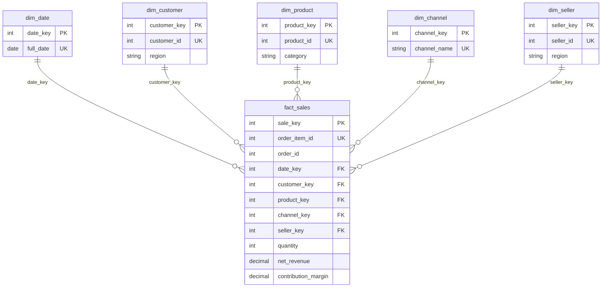

# Star schema

Contrato V2 acrescenta variable_cost_rate (numeric(8,4)), variable_cost_fixed e
variable_cost_value (numeric(18,2)) à fact_sales. Soma de taxas em [0,1), embalagem
>=0, custo derivado >=0; CHECK preserva fórmula da contribuição incluindo custos.
Nova fonte raw/staging.variable_costs tem PK order_item_id e uma linha por item.
Não se junta evento de custo independente à fato nem cria uma fact_costs no MVP.

Power BI real está em powerbi/project; estrutura de cinco dimensões continua.
Desktop adicionou tabelas técnicas ocultas de data automática, separadas das cinco
dimensões de negócio; desabilitar Auto date/time/usar calendário marcado é melhoria
semântica ainda pendente, sem alterar a paridade financeira conferida.

Uma linha em `analytics.fact_sales` por `order_item_id` não cancelado.
`sale_key=order_item_id` é PK estável, order_item_id também UNIQUE;
order_id repete por item. Cada item tem um produto, cliente, canal, vendedor e data.
IDs naturais como keys são aceitáveis no snapshot sintético; não suportam SCD2.

Power BI: 1:* de cada dimensão à fato, relação ativa, filtro unidirecional.
Sem many-to-many. Marcar `dim_date[full_date]` como calendário; ordenar month_name
por month. Calendário contínuo cobrindo anos completos das vendas, inclusive dias
sem movimento. Desabilitar Auto date/time. Região é atributo do cliente; vendedores
fictícios têm região Nacional, sem inferir geografia de atuação.

Devoluções agregadas por item, frete único por pedido e custo único por produto
evitam multiplicação de linhas no join. `targets` tem grão mês/canal e fica em staging,
comparada à fato agregada pela view `vw_target_performance`. Ela não deve ser juntada
à fato em nível item. Views agregadas não substituem o star schema semântico.

FKs PostgreSQL e checks financeiros protegem analytics; validação pré-carga protege
relações de raw/staging. Índices nas cinco FKs e order_id suportam filtros e reconciliação.
