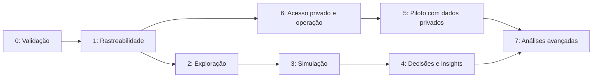

# Relatório de evolução por fases — Sales Profitability Intelligence

**Data:** 08/10/2026 · **Status:** proposta de evolução, sem implementação das fases.

O próximo avanço recomendado é transformar a vitrine atual em uma experiência de
exploração e simulação: filtros compartilhados, comparação de períodos, detalhe
de produtos/canais e cenários de desconto verificáveis. Antes de depender dessas
funcionalidades, fechar a validação do pipeline e tornar as publicações rastreáveis.

Este relatório organiza melhorias técnicas e novas features com dependências,
entregas e critérios de aceite. Não autoriza execução automática, publicação,
contratação de serviços ou uso de dados reais. Cada fase deve terminar com suas
evidências e uma decisão de continuidade. Prazos dependem do escopo escolhido;
os tamanhos abaixo são relativos, não compromissos de calendário.

## 1. Ponto de partida

| Área | Base observada | Limite relevante |
|---|---|---|
| Dados | Oito fontes CSV sintéticas, contratos e validação relacional | Não demonstram integração com uma operação comercial real |
| Finanças | Decimal, CMV, descontos, devoluções, frete, taxas e embalagem | Margem de contribuição não equivale a lucro líquido |
| Warehouse | PostgreSQL raw/staging/analytics e star schema | Full refresh, sem histórico operacional completo ou custos históricos |
| Publicação | Refatoração com lock de sessão, hashes e recuperação dos exports | Nova integração PostgreSQL e Ruff ainda pendentes na última revisão |
| Power BI | Projeto PBIP/TMDL/PBIR e medidas presentes | Refresh, DAX e inspeção visual precisam de evidência própria |
| Web | KPIs, séries mensais, canais, waterfall e quadrante/tabela de produtos | Filtro de categoria localizado; sem simulador web identificado na leitura |
| Insights | Regras determinísticas com limiares e evidências | Sinais ainda não formam um fluxo de acompanhamento de decisões |
| Operação | Scripts e jobs de CI existentes | Sem comprovação de operação SaaS, isolamento por cliente ou recuperação de desastre |

A [revisão de arquitetura](architecture-review-2026-10-08.md) registra 71 testes
Python aprovados, cinco integrações ignoradas e checks web aprovados na execução
anterior deste chat. Esses números são evidência daquela revisão; este relatório
não reexecutou testes, CI, deploy ou Power BI Desktop.

O [modelo de negócios](business-model.md) apresenta uma hipótese comercial.
Usuários reais, disposição a pagar e ganhos financeiros continuam sem validação.

## 2. Sequência recomendada

| Fase | Resultado principal | Prioridade | Tamanho relativo | Dependência |
|---|---|---|---|---|
| 0 | Base validada e documentação consistente | Obrigatória | Pequeno/médio | Ambiente PostgreSQL e ferramentas autorizadas |
| 1 | Execuções e snapshots auditáveis | Alta | Médio | Fase 0 |
| 2 | Dashboard com exploração coordenada | Alta | Grande | Fase 1 e novo contrato agregado |
| 3 | Simulador interativo de decisões comerciais | Alta | Grande | Fase 2 e regras financeiras aprovadas |
| 4 | Insights com investigação e acompanhamento | Média/alta | Médio | Fases 2 e 3 para os recortes oferecidos |
| 5 | Fontes adicionais e histórico de negócio | Condicional | Grande | Fase 1; demanda ou piloto delimitado |
| 6 | Aplicação privada operável por usuários | Condicional | Grande | Fase 1 e requisito de acesso a dados privados |
| 7 | Análises avançadas e previsões avaliadas | Opcional | Grande | Histórico suficiente e problema validado |

Fases 5 e 6 são ramificações de produto, não requisitos para uma boa demonstração
pública. Se um piloto com dados privados for escolhido, executar os controles da
fase 6 **antes** de disponibilizar esses dados ou construir exports públicos.



## 3. Fase 0 — Consolidar a base e fechar as pendências

**Objetivo:** tornar o estado atual verificável antes de ampliar funcionalidades.

**Melhorias propostas:**

- Executar integração PostgreSQL e Ruff em ambiente autorizado, incluindo lock
  após commit, rollback, migração e recuperação sem CSVs locais.
- Validar Power BI separadamente nos modos CSV e PostgreSQL: parâmetros,
  autenticação, refresh, relacionamentos, medidas, filtros e cinco páginas.
- Consolidar a documentação vigente; marcar V1/V2 antigos como históricos para
  evitar instruções conflitantes sobre custos, deploy ou existência do dashboard.
- Registrar baseline de tempo de carga, memória máxima, duração do lock, tamanho
  dos snapshots, tempo de build e tamanho transferido pela web.
- Introduzir tipagem nas fronteiras de configuração, resultados de execução e
  publicação. Separar dependências de runtime e desenvolvimento gradualmente.

**Entregáveis:** relatório de baseline, matriz de checks, instruções de execução
reproduzíveis e evidências Power BI reais.

**Critério de aceite:** os gates aplicáveis passam em banco isolado e CI;
divergências monetárias nos cenários de referência são zero; bloqueios restantes
são explicitados. Um resultado unitário não substitui a prova de integração.

## 4. Fase 1 — Execuções rastreáveis e publicação consistente

**Objetivo:** responder qual execução gerou cada número e recuperar falhas sem
perder a versão consumida pelo dashboard.

**Melhorias de arquitetura:**

- Criar um `run_id` persistido com versão do contrato financeiro, versão do código,
  hashes das fontes, contagens, tempos e estado de execução.
- Separar estados como `started`, `validated`, `warehouse_committed`, `published`
  e `failed`; registrar falha pós-commit sem apagar o commit válido.
- Publicar CSVs em diretório imutável por execução. Atualizar um ponteiro para a
  execução concluída; Power BI deve fixar o mesmo diretório durante todo o refresh.
- Manter histórico de relatórios e política de retenção. Limpeza não pode excluir
  um snapshot ainda referenciado por consumidores.
- Versionar migrações com checksum e detectar alterações em colunas, constraints
  e views; não tratar `IF NOT EXISTS` como migração do contrato.
- Fazer a entrega de fontes por batch concluído e manifest, evitando misturar
  arquivos de duas entregas diferentes.

**Novas features:** página de status dos dados, última atualização bem-sucedida,
histórico de cargas e aviso de snapshot desatualizado. Separar o tempo de execução
do pipeline do período dos dados: recarregar vendas antigas não as torna recentes.

**Critério de aceite:** duas publicações concorrentes não geram bundle misturado;
interrupção entre commit e publicação é recuperável; cada tela aponta para um
run identificável. Testar frescor e retenção com execuções bem-sucedidas e falhas.

## 5. Fase 2 — Dashboard realmente explorável

**Objetivo:** transformar gráficos isolados em uma análise coordenada.

**Novas features:**

- Filtros globais de período, canal, categoria e região, com recorte ativo visível
  e ação para limpar os filtros.
- Comparação com período anterior ou mesmo período do ano anterior, mostrando
  valores, variação percentual e diferenças de margem em pontos percentuais.
- Seleção no gráfico de canais que filtra tendência, quadrante, KPIs e tabela.
- Detalhe de produto com receita, contribuição, devoluções, descontos e composição
  dos custos; análise de canal com o mesmo contrato de indicadores.
- Busca, ordenação e paginação de tabelas; rankings de contribuição, receita e
  baixa margem que respeitam o recorte escolhido.
- Estado dos filtros na URL para compartilhar uma análise; identificação do
  snapshot usado. Um link para uma versão removida deve avisar, sem trocar
  silenciosamente o dado por uma execução mais nova.
- Exportação do recorte com período, filtros, versão financeira e indicação de
  dados sintéticos. Na demonstração pública, manter apenas conteúdo autorizado.

**Arquitetura necessária:** os snapshots atuais têm agregações independentes.
Não é correto obter receita de categoria por mês cruzando totais separados de
produtos e meses. Exportar um novo contrato em grão compatível, por exemplo
`mês × produto × canal × região`, com receita e custos aditivos.

Recalcular margem como `soma(contribuição) / soma(receita líquida)`, nunca pela
média das margens. Pedidos/clientes distintos não são aditivos: usar contagens
calculadas para o recorte no warehouse/API, ou restringir explicitamente esses
indicadores. Não publicar IDs privados para tentar corrigir contagens no navegador.

Para uma demonstração pequena, iniciar com agregados suficientes em snapshots;
adotar API de consulta quando o volume ou a privacidade exigir. Medir cardinalidade
e payload antes de exportar todas as combinações possíveis.

**Critério de aceite:** recortes de referência têm paridade com SQL; todas as
visualizações refletem os mesmos filtros; reset e links compartilhados funcionam.
Cobrir filtros sem resultado, denominador zero, teclado, mobile e legibilidade.
Definir orçamento de desempenho a partir da baseline e medir no dataset alvo.

## 6. Fase 3 — Simulador interativo de desconto e margem

**Objetivo:** apoiar a avaliação de uma decisão comercial, com premissas visíveis.

**Novas features:**

- Controle de desconto entre 0% e 30%, seleção de recorte e meta de margem mínima.
- Comparação atual/simulada de receita líquida, contribuição, margem e taxas.
- Cenários A/B/C, com nome e resumo das premissas.
- Curva desconto × contribuição e indicação do teto sustentável para a meta.
- Variação de frete, custo de produto e volume como entradas de cenários avançados.
- Estimativa de volume necessário para preservar contribuição, exibindo quando
  não existe compensação viável nas premissas do modelo.
- Salvamento local de cenários na demonstração; persistência por usuário somente
  após a implantação de acesso privado da fase 6.

**Arquitetura necessária:** manter o cálculo financeiro central e versionado.
Antes de oferecer controles novos, definir quais custos acompanham receita,
unidades, pedidos ou permanecem constantes. Volume adicional não deve multiplicar
automaticamente todos os custos sem um contrato explícito.

Para cálculo exato com descontos contínuos, preservar arredondamento por item;
coeficientes agregados podem divergir em centavos. Preferir cálculo no serviço
financeiro ou uma grade de cenários pré-calculados para os recortes suportados.
Não enviar a fato privada completa ao navegador. A interface pode oferecer uma
prévia identificada como estimativa, mas o resultado final precisa ser conciliado.

**Critério de aceite:** cenário sem mudança reproduz o atual quando usa os mesmos
descontos por item; cenários uniformes de 0/10/20/30% reproduzem suas referências
Python/SQL/DAX. Receita zero, devolução integral e contribuição negativa não geram
percentuais enganosos. Simulação de volume é hipótese, não previsão de demanda.

## 7. Fase 4 — Insights ligados a investigação e ação

**Objetivo:** levar o usuário de um sinal observado até uma decisão acompanhável.

**Novas features:**

- Central de insights filtrável por impacto monetário, entidade, período e regra.
- Cada insight contém métrica observada, limiar, evidência, recorte, run de origem
  e sugestão de investigação.
- Ação “investigar” abre o detalhe já filtrado; ação “simular” usa o mesmo recorte.
- Decomposição da mudança de contribuição em receita, descontos, devoluções,
  custos e mix, com método explícito e resíduos identificados.
- Registro de decisões com responsável, hipótese, prazo e estados aberto,
  em análise, ação registrada e revisado.
- Limiares configuráveis e deduplicação de alertas. Notificações opt-in apenas
  quando há mudança relevante, com controle de frequência.

**Arquitetura necessária:** separar a detecção da entrega de notificações.
Guardar regra/versão/evidência no momento da detecção. Workflow compartilhado e
notificações externas dependem de fase 6 e autorização de seus usuários; na
demonstração, utilizar exemplos sintéticos e acompanhamento local.

**Critério de aceite:** o mesmo dado não produz alertas duplicados em reruns;
nenhuma mensagem afirma causa sem evidência; o link reproduz o recorte e todas
as parcelas explicativas conciliam com a mudança total. Fechar uma ação não
comprova melhoria financeira: a revisão precisa registrar o resultado observado.

## 8. Fase 5 — Conectores, histórico e modelo de negócio mais completo

**Objetivo:** suportar novas fontes e perguntas sem perder o contrato financeiro.

**Features candidatas:** importação assistida de CSV com mapeamento de colunas;
um conector para ERP/e-commerce escolhido no piloto; custo histórico de produto;
vendas e devoluções por sua data efetiva; metas por canal/região/vendedor e
acompanhamento de execução comercial.

**Melhorias de arquitetura:**

- Interface de adaptadores de fonte, com extrair → normalizar → validar. Regras
  financeiras permanecem independentes de nomes específicos do fornecedor.
- Upload para área privada de quarentena, limites de tamanho, validação e prévia
  antes da carga. Não usar erro de upload como motivo para descartar linhas.
- Carga incremental com watermark, chave de idempotência, correções tardias,
  reprocessamento delimitado e reconciliação contra full refresh.
- Modelar custos por vigência e a regra de devolução por evento; documentar como
  restatar resultados quando um custo histórico é corrigido.
- Adicionar estoque/giro somente quando existir fonte de estoque; não inferir
  saldo ou ruptura usando exclusivamente as vendas atuais.
- Impostos, CAC, despesas fixas e perdas de devolução exigem fonte e regra
  aprovadas. Não renomear contribuição atual para “lucro” após acrescentar taxas.

**Critério de aceite:** uma fonte adicional autorizada passa por contrato,
conciliação e recuperação; atualização incremental produz o mesmo resultado da
carga completa; eventos tardios e mudança de custo têm comportamento testado.
O primeiro conector é escolhido por demanda, não por quantidade de integrações.

## 9. Fase 6 — Acesso privado, colaboração e operação

**Objetivo:** permitir uso com dados privados e usuários reais de forma operável.

**Novas features:** autenticação, perfis de acesso, análises salvas, cenários por
usuário, histórico de decisões e gestão de acesso. Compartilhamento deve distinguir
links públicos da demonstração de links privados de uma organização.

**Melhorias de arquitetura:**

- Separar a vitrine sintética do produto privado; nunca exportar fontes ou dados
  de clientes para `web/public`.
- Implementar autorização no serviço de consulta e segmentar cache, arquivos,
  jobs e cenários pelo contexto autorizado. Não confiar em filtros no frontend.
- Se houver múltiplas organizações, projetar isolamento e testá-lo desde a fonte
  até consulta, publicação, logs e exportação; não tratar uma coluna tenant_id
  como comprovação de isolamento.
- Separar roles PostgreSQL de migração, carga e leitura; configurar segredos,
  transporte seguro, backups e restauração testada.
- Agendamento com retries delimitados e estado durável; erros permanentes de
  contrato pedem intervenção, não repetição infinita.
- Monitorar execução, idade dos dados, reconciliação, latência e falhas de jobs.
  Adicionar trilha de auditoria, retenção e procedimento de recuperação.

**Critério de aceite:** acesso indevido e cruzamento entre organizações são
rejeitados; restore é executado em ambiente isolado; atualização com falha mantém
o último snapshot válido; há responsável e runbook para incidentes. Custos de
infraestrutura/licenças precisam de orçamento próprio antes de contratar serviços.

## 10. Fase 7 — Análises avançadas com avaliação explícita

**Objetivo:** ampliar a análise quando houver histórico e decisões que justifiquem
a complexidade.

**Features candidatas:** coortes de clientes e recompra, decomposição preço/volume/mix,
detecção de anomalias e projeções de receita/contribuição com cenários e intervalos.
Um assistente de perguntas pode ser avaliado depois, consultando somente métricas
autorizadas e mostrando os dados que sustentam cada resposta.

**Melhorias de arquitetura:** datasets de avaliação versionados, testes temporais
sem vazamento, baseline simples e comparação fora da amostra. Projetar comportamento
de abstenção quando os dados forem insuficientes. Um assistente não deve executar
SQL irrestrito ou decidir descontos automaticamente.

**Critério de aceite:** desempenho é medido contra baseline e por período/segmento;
limitações e incerteza aparecem na interface. Os 24 meses sintéticos atuais servem
para demonstrar o fluxo, não para comprovar capacidade preditiva ou elasticidade.
Coortes não comprovam LTV completo sem horizonte e custos adequados. Não oferecer
otimização de preço causal sem dados e desenho de validação apropriados.

## 11. Organização de arquitetura para a evolução

Manter um monólito modular. A estrutura abaixo é alvo proposto, não uma migração
já realizada nem obrigação de renomear todos os módulos na próxima fase.

```text
src/domain/          contratos financeiros, políticas e versões
src/application/     casos de uso de carga, publicação, consulta e simulação
src/ingestion/       adaptadores de fontes
src/database/        repositórios, transações e migrações
src/validation/      contratos, qualidade e conciliação independente
src/analytics/       consultas, cenários e regras de insights
src/interfaces/      CLI e futura API privada, quando necessária
web/                 apresentação, filtros e interação
powerbi/             camada semântica e relatórios versionados
```

Direção de dependência: domínio não importa UI, banco ou conector; casos de uso
coordenam adaptadores; consumidores dependem de contratos versionados. Para dados
públicos, manter snapshots quando suficientes. API, worker e orquestrador entram
por necessidade de consulta privada, operação contínua ou escala medida.

Preservar reconciliação independente: compartilhar uma função financeira entre
produção e seu verificador pode fazer o mesmo defeito passar dos dois lados.
Adicionar recursos com contratos e testes de comportamento; uma nova tela sozinha
não demonstra que a métrica, a autorização ou a operação estão corretas.

## 12. Backlog inicial para deixar a experiência mais dinâmica

| Ordem | Feature | Benefício esperado | Condição técnica |
|---|---|---|---|
| 1 | Período e canal com filtros coordenados | Explorar perguntas sem trocar de ferramenta | Novo agregado compatível; paridade dos recortes |
| 2 | Comparação de períodos | Distinguir crescimento de receita e contribuição | Calendário e denominadores definidos |
| 3 | Detalhe de produto/canal | Entender os componentes de uma margem baixa | Consulta/aggregate no grão correto |
| 4 | Simulador A/B/C | Comparar decisões comerciais | Motor financeiro versionado e cenários conciliados |
| 5 | Insights com links para investigar | Reduzir o caminho entre alerta e análise | Evidência reproduzível por snapshot |
| 6 | Exportação e links de recortes | Facilitar apresentação e revisão de decisões | Filtros, versão, privacidade e retenção |

Interatividade deve facilitar leitura e decisão. Usar transições curtas para
mudanças de estado, suporte a movimento reduzido, foco de teclado e alternativas
textuais aos gráficos. Reservar cor para dados e significados consistentes;
carregamento, falha, vazio, desatualização e ausência de dados precisam de estados
claros. Animações decorativas e mapa geográfico sem pergunta útil ficam fora do
backlog prioritário.

**Primeiro marco de produto recomendado:** fases 0 e 1 concluídas, seguido da fase
2 com período/canal, comparação e detalhe. **Segundo marco:** simulador web da
fase 3 e investigação dos insights na fase 4. As fases seguintes dependem de
demanda, dados e condições operacionais demonstrados.

## 13. Evidências exigidas ao fechar cada fase

| Dimensão | Evidência de conclusão |
|---|---|
| Negócio | Pergunta respondida, premissas e responsável pela interpretação |
| Dados | Contrato, origem/run, qualidade e reconciliação do recorte |
| Arquitetura | Decisão registrada, dependências e estratégia de falha/recuperação |
| Experiência | Desktop/mobile, teclado, estados sem dados e interação principal |
| Operação | Testes aplicáveis, configuração reproduzível, logs e limites conhecidos |
| Entrega | Documentação vigente e pendências explícitas antes da próxima fase |

## Referências internas

- [Revisão de arquitetura e validação](architecture-review-2026-10-08.md).
- [ADR-006 — publicação recuperável](adr/006-recoverable-publication.md).
- [Contrato financeiro vigente](business-rules.md).
- [Modelo dimensional](data-model.md).
- [Hipótese de modelo de negócios](business-model.md).
- [Plano sênior anterior](history/senior-delivery-plan.md), preservado como contexto;
  a situação do código e a revisão atual prevalecem sobre diagnósticos antigos.

Não foram pesquisados preços, versões de novos fornecedores ou tendências de
mercado para este relatório. As propostas derivam das necessidades e limitações
observadas no projeto; adoção de serviços externos requer avaliação específica.
